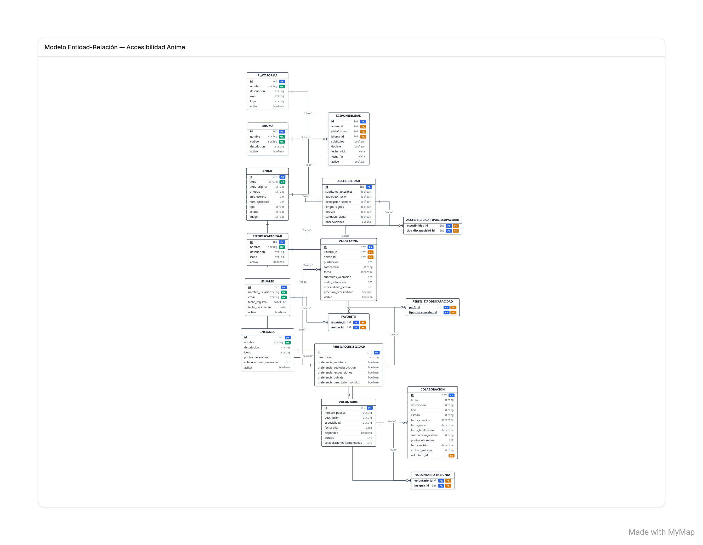

# AnimeAccess — Modelos de la base de datos

> Documentación de los 12 modelos Django de **AnimeAccess**, una plataforma orientada a consultar la disponibilidad del anime y sus características de accesibilidad.

## Índice

1. [Introducción](#-introducción)
2. [Diagrama entidad-relación](#-diagrama-entidad-relación)
3. [Resumen de los modelos](#-resumen-de-los-modelos)
4. [Descripción detallada](#-descripción-detallada-de-los-modelos)
5. [Relaciones principales](#-relaciones-principales)
6. [Tipos de campos utilizados](#-tipos-de-campos-utilizados)

---

## Introducción

La base de datos de AnimeAccess está organizada en **12 modelos**. Cada modelo representa un elemento de la aplicación, como los animes, las plataformas de streaming, los usuarios, las preferencias de accesibilidad o las colaboraciones de voluntariado.

Esta estructura permite organizar la información y relacionar los datos necesarios para consultar la accesibilidad del anime, valorar la experiencia y colaborar en la mejora de los recursos accesibles.

## Diagrama entidad-relación

El siguiente diagrama representa visualmente los modelos y las relaciones entre ellos.

*Figura 1. Diagrama entidad-relación de la base de datos de AnimeAccess.*

> **Importante:** la ruta de la imagen es relativa al archivo `README.md`. Si esta documentación está en una subcarpeta, ajusta la ruta para que apunte a `` desde ese archivo.

## Resumen de los modelos

| N.º | Modelo | ¿Para qué sirve? |
|---:|---|---|
| 1 | `Anime` | Guarda la información principal de cada anime. |
| 2 | `Plataforma` | Registra las plataformas donde puede verse anime. |
| 3 | `Disponibilidad` | Indica en qué plataforma, idioma y condiciones está disponible un anime. |
| 4 | `Accesibilidad` | Recoge las características de accesibilidad de un anime. |
| 5 | `TipoDiscapacidad` | Clasifica las necesidades de accesibilidad que puede cubrir la aplicación. |
| 6 | `Idioma` | Mantiene el catálogo de idiomas disponibles. |
| 7 | `Usuario` | Guarda los datos básicos de las cuentas de usuario. |
| 8 | `PerfilAccesibilidad` | Almacena las preferencias de accesibilidad de cada usuario. |
| 9 | `Valoracion` | Permite valorar un anime y sus características de accesibilidad. |
| 10 | `Voluntario` | Registra a los usuarios que colaboran en el proyecto. |
| 11 | `Colaboracion` | Organiza las tareas realizadas por los voluntarios y su estado. |
| 12 | `Insignia` | Define los logros que pueden obtener los voluntarios. |

---

## Descripción detallada de los modelos

### 1. `Anime` — Catálogo de anime

Almacena la información básica de cada anime.

**Datos principales:**
- `titulo` y `titulo_original`: título habitual y título original.
- `sinopsis`: resumen del anime.
- `anio_estreno`: año de estreno, limitado mediante validadores.
- `num_episodios`: número de episodios.
- `tipo` y `estado`: clasificación y situación del anime.
- `imagen`: imagen opcional del anime.

**Relaciones:**
- Se relaciona con `Plataforma` mediante `Disponibilidad`.
- Puede marcarse como favorito por muchos usuarios.
- Puede tener una ficha de `Accesibilidad` y recibir varias `Valoracion`.

### 2. `Plataforma` — Servicios de streaming

Guarda los datos de las plataformas en las que se puede consumir anime.

**Datos principales:** nombre, descripción, dirección web, logotipo y estado de actividad.

**Relaciones:** una plataforma puede tener muchas entradas en `Disponibilidad`, correspondientes a diferentes animes e idiomas.

### 3. `Disponibilidad` — Dónde y cómo ver un anime

Es el modelo intermedio entre `Anime` y `Plataforma`. Añade información propia a esa relación.

**Datos principales:**
- `anime`, `plataforma` e `idioma`.
- `subtitulos` y `doblaje`: indican si esa disponibilidad cuenta con subtítulos o doblaje.
- `fecha_inicio` y `fecha_fin`: fechas opcionales de disponibilidad.
- `activo`: indica si la disponibilidad sigue vigente.

El modelo impide registrar dos veces la misma combinación de anime, plataforma e idioma mediante una restricción de unicidad.

### 4. `Accesibilidad` — Características accesibles del anime

Contiene la ficha de accesibilidad asociada a un anime.

**Características registradas:**
- Subtítulos accesibles.
- Audiodescripción.
- Descripción de sonidos.
- Lengua de signos.
- Doblaje.
- Contraste visual.
- Observaciones adicionales.

También puede relacionarse con varios registros de `TipoDiscapacidad`. Cada anime puede tener como máximo una ficha de accesibilidad.

### 5. `TipoDiscapacidad` — Clasificación de necesidades

Permite definir los tipos de necesidades de accesibilidad que la plataforma tiene en cuenta.

Incluye un nombre, una descripción, un campo opcional para identificar un icono y un indicador para activar o desactivar el tipo.

Se utiliza tanto en las fichas de `Accesibilidad` como en los `PerfilAccesibilidad` de los usuarios.

### 6. `Idioma` — Idiomas disponibles

Mantiene un catálogo común de idiomas.

**Datos principales:**
- `nombre`: nombre del idioma.
- `codigo`: código identificativo.
- `descripcion`: explicación opcional.
- `activo`: indica si el idioma está disponible para su uso.

Se utiliza en `Disponibilidad` para especificar el idioma correspondiente a cada anime y plataforma.

### 7. `Usuario` — Cuentas de la aplicación

Almacena la información básica de las personas registradas en AnimeAccess.

Incluye nombre de usuario, correo electrónico, fecha de registro, fecha de nacimiento opcional y estado de la cuenta. El nombre de usuario y el correo electrónico deben ser únicos.

Además, los usuarios pueden guardar animes como favoritos, crear un perfil de accesibilidad, publicar valoraciones y disponer de un perfil de voluntariado.

### 8. `PerfilAccesibilidad` — Preferencias personales

Guarda las preferencias de accesibilidad de un usuario.

Puede incluir preferencias de subtítulos, audiodescripción, lengua de signos, doblaje y descripción de sonidos, además de una descripción opcional y los tipos de necesidades relacionados.

La relación uno a uno con `Usuario` permite que cada usuario tenga como máximo un perfil de accesibilidad.

### 9. `Valoracion` — Opiniones de los usuarios

Registra la valoración de un anime realizada por un usuario.

**Datos principales:**
- `usuario` y `anime`: identifican quién valora y qué anime valora.
- `puntuacion`: nota general del 1 al 5.
- `comentario`: texto opcional.
- `fecha`: momento de creación.
- `subtitulos_valoracion`, `audio_valoracion` y `accesibilidad_general`: valoraciones específicas del 1 al 5.
- `precision_accesibilidad`: puntuación decimal para una valoración más precisa.
- `visible`: controla si la valoración se muestra.

Los validadores limitan las puntuaciones a los rangos definidos en el modelo.

### 10. `Voluntario` — Personas colaboradoras

Representa a un usuario que participa voluntariamente en tareas para mejorar la accesibilidad del proyecto.

Incluye nombre público, descripción, especialidad, fecha de alta, disponibilidad, puntos acumulados y número de colaboraciones completadas.

Cada voluntario está asociado a una cuenta de `Usuario` y puede conseguir varias `Insignia`.

### 11. `Colaboracion` — Tareas de voluntariado

Organiza las tareas que realizan los voluntarios.

**Tipos de colaboración definidos:** audiodescripción, subtítulos accesibles, lengua de signos y revisión de accesibilidad.

**Estados posibles:** pendiente, en proceso, en revisión, aprobada o rechazada.

También almacena título, descripción, fechas de creación, inicio y finalización, comentarios de revisión, puntos obtenidos y un archivo opcional con el resultado de la tarea.

Cada colaboración pertenece a un voluntario.

### 12. `Insignia` — Logros y reconocimientos

Define las insignias que los voluntarios pueden obtener por su participación.

Incluye nombre, descripción, icono opcional, puntos necesarios, número de colaboraciones necesarias y un indicador para activar o desactivar la insignia.

La relación con `Voluntario` es de muchos a muchos: una insignia puede corresponder a varios voluntarios y un voluntario puede conseguir distintas insignias.

---

## Relaciones principales

| Relación | Tipo | Explicación |
|---|---|---|
| `Anime` — `Plataforma` | Muchos a muchos mediante `Disponibilidad` | Un anime puede estar en varias plataformas y una plataforma puede ofrecer muchos animes. |
| `Anime` — `Usuario` (favoritos) | Muchos a muchos | Un usuario puede guardar varios animes y un anime puede ser favorito de muchos usuarios. |
| `Anime` — `Accesibilidad` | Uno a uno | Cada anime puede tener una única ficha de accesibilidad. |
| `Disponibilidad` — `Idioma` | Muchos a uno | Cada disponibilidad usa un idioma; un idioma puede aparecer en muchas disponibilidades. |
| `Accesibilidad` — `TipoDiscapacidad` | Muchos a muchos | Una ficha puede cubrir varios tipos y un tipo puede aparecer en varias fichas. |
| `Usuario` — `PerfilAccesibilidad` | Uno a uno | Cada usuario puede tener un perfil de preferencias. |
| `PerfilAccesibilidad` — `TipoDiscapacidad` | Muchos a muchos | Un perfil puede asociarse a varios tipos de necesidades. |
| `Usuario` — `Valoracion` | Uno a muchos | Un usuario puede publicar varias valoraciones. |
| `Anime` — `Valoracion` | Uno a muchos | Un anime puede recibir valoraciones de distintos usuarios. |
| `Usuario` — `Voluntario` | Uno a uno | Una cuenta puede tener un perfil de voluntario. |
| `Voluntario` — `Colaboracion` | Uno a muchos | Un voluntario puede realizar varias colaboraciones. |
| `Voluntario` — `Insignia` | Muchos a muchos | Un voluntario puede obtener varias insignias y una insignia puede ser obtenida por varias personas. |

### ¿Qué significan los tipos de relación de Django?

- **`ForeignKey`**: relaciona muchos registros con uno. Por ejemplo, muchas colaboraciones pueden pertenecer al mismo voluntario.
- **`OneToOneField`**: establece una relación uno a uno. Por ejemplo, un usuario tiene como máximo un perfil de accesibilidad.
- **`ManyToManyField`**: permite relacionar varios registros de un modelo con varios de otro.
- **`through="Disponibilidad"`**: indica que la relación entre anime y plataforma utiliza el modelo `Disponibilidad` como tabla intermedia con datos propios.

---

## Tipos de campos utilizados

| Campo Django | Uso en AnimeAccess |
|---|---|
| `CharField` | Textos cortos, como nombres, títulos, estados o códigos. |
| `TextField` | Textos largos, como sinopsis, descripciones y comentarios. |
| `PositiveIntegerField` | Números enteros no negativos, como episodios, puntos o colaboraciones. |
| `PositiveSmallIntegerField` | Enteros pequeños no negativos, como puntuaciones y años almacenados en un rango limitado. |
| `IntegerField` | Números enteros. |
| `BooleanField` | Valores verdadero/falso para preferencias, estados y características. |
| `DateField` | Fechas sin hora. |
| `DateTimeField` | Fechas con hora, como el registro o la revisión. |
| `EmailField` | Direcciones de correo electrónico. |
| `URLField` | Direcciones web. |
| `ImageField` | Imágenes, como portadas, logotipos e iconos. |
| `FileField` | Archivos adjuntos, como entregas de colaboraciones. |
| `DecimalField` | Números decimales con precisión definida. |
| `ForeignKey` | Relación de muchos a uno. |
| `OneToOneField` | Relación de uno a uno. |
| `ManyToManyField` | Relación de muchos a muchos. |

### Opciones y validadores útiles

- `max_length`: limita la longitud de un texto.
- `blank=True`: permite dejar el campo vacío en formularios y validaciones de Django.
- `null=True`: permite guardar `NULL` en la base de datos.
- `default`: define un valor inicial por defecto.
- `unique=True`: evita valores duplicados en el campo.
- `choices`: limita las opciones disponibles a una lista definida.
- `validators`: aplica validaciones, como limitar una puntuación entre 1 y 5.
- `on_delete=models.CASCADE`: elimina los registros relacionados cuando se elimina el registro principal.
- `on_delete=models.PROTECT`: impide eliminar un registro si sigue protegido por relaciones existentes.
- `related_name`: define el nombre utilizado para acceder a los objetos relacionados desde el otro modelo.

---

## Conclusión

Los 12 modelos de AnimeAccess separan la información del catálogo, la disponibilidad en plataformas, la accesibilidad, las cuentas de usuario, las valoraciones y el voluntariado. Las relaciones entre ellos permiten mantener los datos organizados y facilitar la ampliación futura de la aplicación.

## Instalación necesaria para las fotos

Para poder usar correctamente el `upload_to = " "` se debe hacer la instalacion de la libreria Pillow con un `python -m pip install Pillow`